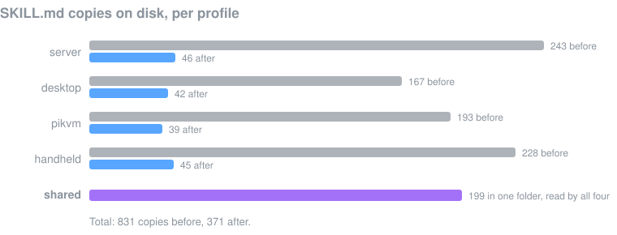

<div align="center">

# commons

**One live skill library for every Hermes profile.**

[](https://github.com/Chrisyk/hermes-commons/tags)
[](LICENSE)
[](https://github.com/NousResearch/hermes-agent)
[](pyproject.toml)

[Install](#install) · [What it does](#what-it-does) · [Consistency](#several-agents-writing-one-skill) · [Upgrading](#upgrading) · [Guild vs commons](#how-it-differs-from-guild) · [Disclosure](#what-it-touches-disclosure)


</div>

---

If you run several Hermes profiles (a coding agent, a home-lab agent, a phone agent), each one
keeps its own `skills/` folder. Over time the same skill ends up copied into every profile and
each copy drifts: one agent fixes a pitfall, the others never learn it. commons moves your
skills into one shared folder that every profile reads and edits in place, so a fix made by one
agent is live for all of them on the next turn, with every edit kept in git.

## Why I made it

I run four Hermes profiles. When I audited them, 246 skills had 53 different versions across
profiles, 42 of them real conflicts, and the skill index took 50 to 60 percent of every prompt.
Hermes can already point every profile at one folder (`skills.create_dir`), but nothing helps
you get there safely, or tells you when a private copy starts hiding the shared one again.
commons does that part.

<p align="center">
  
</p>

After setup, each profile keeps only the skills that really belong to it, and everything else
lives once in the shared folder:

<p align="center">
  
</p>

The numbers are from my own four profiles on 2026-11-20. `scripts/readme_charts.py` draws the
charts.

## What it does

- **Setup with a review step.** `hermes commons setup` scans every profile, reports identical
  skills, copies that are contained in another copy, real conflicts and skills that must stay
  local, and proposes a merge plan. Nothing changes until you choose apply. Apply backs up
  every profile first, moves old copies into the backup (it never deletes), points every
  profile at the shared folder and verifies that every skill still resolves.
- **Per-edit git history.** Each time an agent creates, edits or patches a shared skill
  through Hermes' skill tool, commons commits it, labelled with the profile and session.
  `hermes commons log S` and `hermes commons undo S` work per skill.
- **Drift checks.** `hermes commons check` reports private copies that shadow a shared skill,
  ambiguous names, uncommitted edits, stale paths, broken frontmatter, missing references,
  oversize skills, and bundled or hub skills you took over that have a newer upstream version.
  `/commons status` and `/commons check` work inside a chat (read-only).
- **Merging conflicts.** `hermes commons merge --next` hands one conflict at a time to you or
  your agent with a staging folder; `--accept` refuses while any line of any variant would be
  lost.
- **Promote and demote.** Share a profile's skill, or give one profile an intentional private
  copy that check will not flag.
- **Restore.** `hermes commons restore` lists backups and undoes setup, a merge, a promote or a
  demote. It works step by step from a write-ahead journal, so a crash at any point can be
  undone, and it keeps edits you made after the operation.

## Several agents writing one skill

Hermes locks a skill while one profile writes it, but each profile uses its
own lock folder, so two profiles writing the same shared skill at once can
lose an edit. An agent can also rewrite a skill from a copy it read minutes
ago. Two settings handle this; you choose how much consistency to trade for
speed:

```
hermes commons config set lock shared    # one lock for every profile (own = Hermes' default)
hermes commons config set guard warn     # off | warn | strict: catch writes based on an old read
```

- `lock shared` reuses Hermes' own lock, so a write waits only while another
  profile writes the same skill. With it on, a version replaced before its
  commit is kept and reported.
- `guard strict` refuses a stale write and tells the agent to re-read and
  re-apply; `warn` only logs it. The guard can differ per profile
  (`guard.<profile>`).

A new setup uses `lock shared`; existing installs keep `lock own` and
`guard off` until you change them. Details and limits:
[docs/consistency.md](docs/consistency.md).

## Upgrading

```
hermes plugins update commons
hermes commons config set lock shared    # optional, recommended
hermes commons check
```

An update changes no setting. Restart the gateway and open chats after
updating (and after turning the guard on) so they load the new code. If
`update` says the plugin is pinned, reinstall it:
`hermes plugins install Chrisyk/hermes-commons --enable`.

## How it differs from Guild

[Guild](https://github.com/Nnadijoshuac/hermes-guild) is a team library: skills are proposed,
reviewed and then loaded read-only from a git clone that each profile syncs. commons is for one
person's profiles on one machine: there is one live folder, agents edit it in place, and an
edit is visible to every profile immediately, with git as the history rather than the
transport.

## Install

Requires Hermes 0.23.0 or later, Linux or macOS, and `git`.

```
hermes plugins install Chrisyk/hermes-commons --enable
hermes commons setup
```

Setup prints the proposal and writes it to `<hermes home>/commons/proposals/`. Then:

```
hermes commons setup --choose my-skill=keep:coder   # optional, per conflict
hermes commons setup --apply
hermes commons check
```

Enable the plugin in each profile that should get per-edit commits (setup proposes this).
Setup can also add an hourly `hermes commons check --fix-safe --quiet` cron job
(`setup --apply --schedule`).

## What it touches (disclosure)

- Reads every profile's `config.yaml`, skills folders, bundled manifest, hub lock and cron
  `jobs.json`.
- With `lock shared`: replaces each profile's `skills/.locks` folder with a symlink to
  `<hermes home>/commons/skill-locks/` (the old folder is moved into a backup).
- With the guard on: reads the skill and shared-folder files your agents view or write, to
  compare versions, and logs refusals to `<hermes home>/commons/guard.log`.
- On apply and the other writing commands, after asking: writes the shared skills folder,
  runs local `git` in it (hooks disabled, no prompts, 30 s timeout), sets `skills.create_dir`
  and adds `commons` to `plugins.enabled` through `hermes config set`, moves replaced skill
  folders into `<hermes home>/commons/backups/`, and rewrites old skill paths in cron prompts
  only where the new file exists.
- Makes no network calls and stores no credentials. Backups contain copies of `config.yaml`,
  which may hold secrets; they stay on your machine, outside every skills folder and outside
  git.

## Limitations

- The per-edit hook and the guard only see edits made through Hermes' tools. Files edited by
  hand or by shell commands are caught by `check` (uncommitted) and committed by
  `check --fix-safe`.
- Windows hosts are not supported (commons needs `fcntl`).
- Containment ignores trailing whitespace, CRLF versus LF, and a newer `version:` line in the
  copy being retired. Anything else, including line order, counts as a difference.

## Development

```
python -m venv .venv && .venv/bin/pip install -e '.[test]'
.venv/bin/python -m pytest -q
```

The tests that compare commons against Hermes' own skill discovery, hashing and index code run
when a Hermes runtime is found (override with `COMMONS_HERMES_PYTHON`). `COMMONS_HERMES_ROOT`
points every command at a sandbox Hermes root; it is for testing only.

## License

MIT
